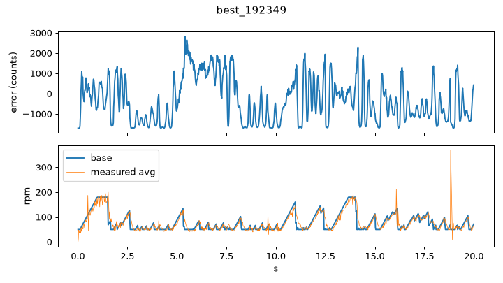
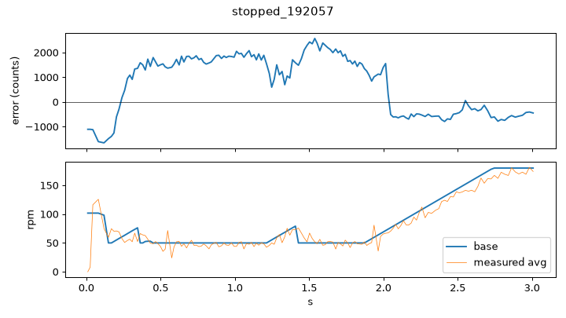
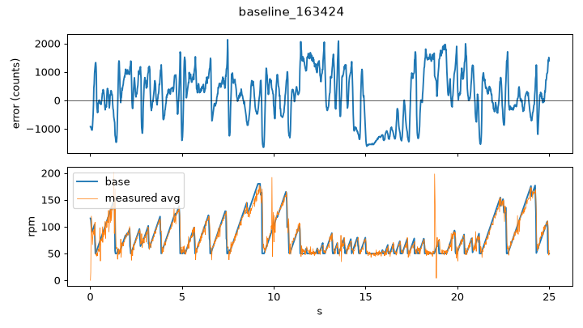

# Entry 4: Oct 20 tuning session at 180 rpm

Date: Oct 20, 16:32 to 19:25. 39 runs in `follow/`, all at `BASE_RPM = 180`. Code: `Lab9/line_follow.py` (commits `3a3514b` to `edf4480`). Passages marked **[YOU]** are for me to fill in from memory.

## Words used below

- `BASE_RPM`: speed the rover tries to hold on straights (180). `MAX_RPM = 220`: cap per wheel, the motors top out at about 225-230 rpm. If the outer wheel would go above it, both wheels are lowered by the excess so the turn stays.
- `cr` / `CORNER_RPM`: lowest base speed allowed in curves. The base speed drops when |error| grows (from `SLOW_DEAD` to `SLOW_ERR`); `cr` is the floor so it never drops to 0. `cr50` in a filename means 50 rpm.
- `SLOW_DEAD`: errors below this do not slow the rover (straight wobble is about +-430). `SLOW_RECOVER`: speed climbs back at most this many rpm per second; dropping is instant. `SLOW_DROP`: limit on how fast it may drop (tried, later deleted).
- `slow_samples`: slow down on the smallest |error| of the last N readings. N = 1 is off. A 1-2 reading spike on a straight is ignored with N >= 3, and a real corner (8+ readings) still slows about 2 readings later.
- `BRAKE_MARGIN`: a wheel gets the DRV8833 short brake if it is this many rpm above its target (rpm noise is +-9).
- `kds`: D term of the steering loop. `ks`, `kis`: P and I of the steering loop.

## 1. Starting point (runs 1-3, 16:32)

Entry 2 ended with 180 rpm working at `ks = 0.013`. Three runs showed how fragile it was: one stopped at 10.8 s, the other two finished 25 s with a mean error of about 740. **[YOU: what "stopped" meant, e.g. lost the line in the M.]**

## 2. Is `ks` the problem? (runs 4-8, 18:10-18:24)

After a break I swept `ks`: 0.013, 0.0105, 0.0085, 0.0095. All five runs finished 25 s, with mean error 800-860. No clear winner, but lower `ks` gave bigger peaks (up to about 4000 against 2400), so I used 0.0095 for the next experiments. **[YOU: why 0.0095.]**

## 3. Adding a D term (runs 9-14, 18:29-18:40)

With `kds = 0.0001` the first two runs were fine (mean 792 and 795, 25 s), but the 20 s runs got worse, up to a mean of 1292. This matches entry 1: D adds noise. I went back to `kds = 0`.

## 4. Slowing down differently (runs 15-24, 18:41-18:56)

I raised `SLOW_DEAD` to 800 and `SLOW_RECOVER` to 150, and tried `SLOW_DROP` 800 and 600 to stop it entering corners too fast. Results were mixed: 15 and 16 ran 20 s, but with `SLOW_DROP` 600/800 five runs stopped after 2-5 s (18, 19, 22, 23, 24). Runs 17, 20 and 21 finished (20, 20 and 25 s). **[YOU: why drop limiting made it lose the first corner; the code comment says it entered corners at 110-165 rpm.]**

## 5. How low can corners go? (runs 25-33, 19:02-19:14)

I compared `cr` 50 and 55. At 55, one run stopped at 4.4 s, one at 7.3 s, and one finished 20 s. At 50, runs stopped at 11.4, 1.8 and 15 s, and one finished 25 s (190720). The code comment sums it up: 50 holds, 55 held 1 of 3 runs. Then I went back to `kds = 0` and `ks` 0.013 and 0.0115 with `cr50`; both finished 20 s (mean 907 and 949).

## 6. Ignoring spikes: `slow_samples` (runs 34-39, 19:20-19:25)

The idea (commit `9d4eea5`): a quick stop on a straight is a 1-2 reading spike, not a corner. If I only slow down when the smallest error of the last N readings is large, spikes are ignored. I tried N = 3 (three runs, stopped at 3.0, 3.6 and 4.3 s) and N = 2 (stopped at 4.0 s). **[YOU: why N = 2, 3 failed, e.g. slowing two readings late.]** With N = 1 (filter off) and `brake_margin = 70` the rover finished (run 38, 192349). With `brake_margin = 90` it stopped at 13.2 s, so I kept 70.

Plots below: the best run, a run that stopped, and the baseline.

## Result

Best run: `follow/base180_ks0.0115_sp2000_kis0.01_kds0_cr50_it12_192349.csv`, 20 s, mean error 984, max 2828 (`python line_follow.py 180 20 0.0115 2000 0.01 50`). Its mean error is not the lowest (the first baseline runs have about 740, at the older, slower thresholds). It is the best because the nearby settings kept losing the line and this one did not. After the session I removed `SLOW_SAMPLES`, `SLOW_DROP`, `SLOW_TURN` and `KDS` from the code (`edf4480`, `21d4d6e`).

Caveats: "stopped" is judged from the log ending before the set time, since the logs have no outcome field. The mean error of runs under about 6 s only covers the first corner. Results vary with battery and lighting.

## Appendix: all runs

Times are from the filenames. Dur = last timestamp in the log (set run time was 20 or 25 s).

| # | Time | ks | Changed | Dur (s) | Mean err | Log file (in `follow/`) |
|---|---|---|---|---|---|---|
| 1 | 16:32:43 | 0.013 | baseline | 10.8 | 1093 | `base180_ks0.013_sp2000_kis0.01_it12_163243.csv` |
| 2 | 16:33:21 | 0.013 | baseline | 25.0 | 748 | `base180_ks0.013_sp2000_kis0.01_it12_163321.csv` |
| 3 | 16:34:24 | 0.013 | baseline | 25.0 | 738 | `base180_ks0.013_sp2000_kis0.01_it12_163424.csv` |
| 4 | 18:10:59 | 0.013 | | 25.0 | 797 | `base180_ks0.013_sp2000_kis0.01_it12_181059.csv` |
| 5 | 18:13:01 | 0.0105 | | 25.0 | 859 | `base180_ks0.0105_sp2000_kis0.01_it12_181301.csv` |
| 6 | 18:14:32 | 0.0085 | | 25.0 | 827 | `base180_ks0.0085_sp2000_kis0.01_it12_181432.csv` |
| 7 | 18:16:41 | 0.0095 | | 25.0 | 819 | `base180_ks0.0095_sp2000_kis0.01_it12_181641.csv` |
| 8 | 18:24:48 | 0.0095 | | 25.0 | 852 | `base180_ks0.0095_sp2000_kis0.01_it12_182448.csv` |
| 9 | 18:29:00 | 0.0095 | kds 0.0001 | 25.0 | 792 | `base180_ks0.0095_sp2000_kis0.01_kds0.0001_it12_182900.csv` |
| 10 | 18:35:48 | 0.0095 | kds 0.0001 | 25.0 | 795 | `base180_ks0.0095_sp2000_kis0.01_kds0.0001_it12_183548.csv` |
| 11 | 18:36:49 | 0.0095 | kds 0.0001 | 20.0 | 837 | `base180_ks0.0095_sp2000_kis0.01_kds0.0001_it12_183649.csv` |
| 12 | 18:38:54 | 0.0095 | kds 0.0001 | 20.0 | 1292 | `base180_ks0.0095_sp2000_kis0.01_kds0.0001_it12_183854.csv` |
| 13 | 18:39:33 | 0.0095 | kds 0.0001 | 20.0 | 1250 | `base180_ks0.0095_sp2000_kis0.01_kds0.0001_it12_183933.csv` |
| 14 | 18:40:14 | 0.0095 | kds 0.0001 | 20.0 | 1009 | `base180_ks0.0095_sp2000_kis0.01_kds0.0001_it12_184014.csv` |
| 15 | 18:41:57 | 0.0095 | kds 0 | 20.0 | 833 | `base180_ks0.0095_sp2000_kis0.01_kds0_it12_184157.csv` |
| 16 | 18:44:29 | 0.0095 | slow_dead 800, recover 150 | 20.0 | 906 | `base180_ks0.0095_sp2000_kis0.01_kds0_it12_184429.csv` |
| 17 | 18:48:50 | 0.0095 | slow_drop 800 | 20.0 | 987 | `base180_ks0.0095_sp2000_kis0.01_kds0_it12_184850.csv` |
| 18 | 18:50:13 | 0.0095 | slow_drop 600 | 2.1 | 1746 | `base180_ks0.0095_sp2000_kis0.01_kds0_it12_185013.csv` |
| 19 | 18:50:34 | 0.0095 | slow_drop 600 | 3.9 | 937 | `base180_ks0.0095_sp2000_kis0.01_kds0_it12_185034.csv` |
| 20 | 18:51:51 | 0.0095 | slow_drop 800 | 20.0 | 998 | `base180_ks0.0095_sp2000_kis0.01_kds0_it12_185151.csv` |
| 21 | 18:55:07 | 0.0095 | slow_drop 800 | 25.0 | 963 | `base180_ks0.0095_sp2000_kis0.01_kds0_it12_185507.csv` |
| 22 | 18:55:58 | 0.0095 | slow_drop 800 | 5.0 | 729 | `base180_ks0.0095_sp2000_kis0.01_kds0_it12_185558.csv` |
| 23 | 18:56:22 | 0.0095 | slow_drop 800 | 5.0 | 1018 | `base180_ks0.0095_sp2000_kis0.01_kds0_it12_185622.csv` |
| 24 | 18:56:44 | 0.0095 | slow_drop 800 | 4.7 | 1003 | `base180_ks0.0095_sp2000_kis0.01_kds0_it12_185644.csv` |
| 25 | 19:02:59 | 0.0095 | cr55, slow_drop 800 | 4.4 | 1036 | `base180_ks0.0095_sp2000_kis0.01_kds0_cr55_it12_190259.csv` |
| 26 | 19:03:28 | 0.0095 | cr50, slow_drop 800 | 11.4 | 1116 | `base180_ks0.0095_sp2000_kis0.01_kds0_cr50_it12_190328.csv` |
| 27 | 19:07:20 | 0.0095 | cr50, slow_drop off | 25.0 | 938 | `base180_ks0.0095_sp2000_kis0.01_kds0_cr50_it12_190720.csv` |
| 28 | 19:07:59 | 0.0095 | cr50 | 1.8 | 1370 | `base180_ks0.0095_sp2000_kis0.01_kds0_cr50_it12_190759.csv` |
| 29 | 19:08:21 | 0.0095 | cr50 | 15.0 | 982 | `base180_ks0.0095_sp2000_kis0.01_kds0_cr50_it12_190821.csv` |
| 30 | 19:09:24 | 0.0095 | cr55 | 20.0 | 965 | `base180_ks0.0095_sp2000_kis0.01_kds0_cr55_it12_190924.csv` |
| 31 | 19:09:53 | 0.0095 | cr55 | 7.3 | 659 | `base180_ks0.0095_sp2000_kis0.01_kds0_cr55_it12_190953.csv` |
| 32 | 19:13:09 | 0.013 | cr50 | 20.0 | 907 | `base180_ks0.013_sp2000_kis0.01_kds0_cr50_it12_191309.csv` |
| 33 | 19:14:40 | 0.0115 | cr50 | 20.0 | 949 | `base180_ks0.0115_sp2000_kis0.01_kds0_cr50_it12_191440.csv` |
| 34 | 19:20:57 | 0.0115 | slow_samples 3, margin 70 | 3.0 | 1264 | `base180_ks0.0115_sp2000_kis0.01_kds0_cr50_it12_192057.csv` |
| 35 | 19:21:13 | 0.0115 | slow_samples 3, margin 70 | 4.3 | 1014 | `base180_ks0.0115_sp2000_kis0.01_kds0_cr50_it12_192113.csv` |
| 36 | 19:22:00 | 0.0115 | slow_samples 3, margin 70 | 3.6 | 854 | `base180_ks0.0115_sp2000_kis0.01_kds0_cr50_it12_192200.csv` |
| 37 | 19:22:42 | 0.0115 | slow_samples 2, margin 70 | 4.0 | 814 | `base180_ks0.0115_sp2000_kis0.01_kds0_cr50_it12_192242.csv` |
| 38 | 19:23:49 | 0.0115 | slow_samples 1, margin 70 | 20.0 | 984 | `base180_ks0.0115_sp2000_kis0.01_kds0_cr50_it12_192349.csv` |
| 39 | 19:25:18 | 0.0115 | slow_samples 1, margin 90 | 13.2 | 981 | `base180_ks0.0115_sp2000_kis0.01_kds0_cr50_it12_192518.csv` |
